# Atelier Art Gallery

Atelier is a student art gallery with six original illustrations, fictional artist profiles, and virtual exhibitions.

**Group members** Zhanserik Zharylgassyn and Erkebulan Korganbek

**Project links** [Final repository](https://github.com/znsrk/atelier-art-gallery-final) · [GitHub Pages](https://znsrk.github.io/atelier-art-gallery-final/) · [Endterm repository](https://github.com/znsrk/atelier-art-gallery-endterm)

## Project report

[Download the project report (Word)](docs/AtelierProjectReport.docx)

## Features

- Nine responsive pages with shared navigation and a light/dark setting saved in the browser.
- A validated sign-in demo that saves the visitor's display name until they sign out.
- Five gallery FAQs that open and close with jQuery's `.slideToggle()`.
- Live artwork search from the [Cleveland Museum of Art API](https://openaccess-api.clevelandart.org/), with artwork links and feedback for empty results or outages.
- A searchable student collection with a keyboard-friendly lightbox, a personal exhibition planner, and the original registration and contact demos.

## Run locally

From this folder, run `python -m http.server 8000` and open `http://localhost:8000/`. The website has no build step. Bootstrap, jQuery, and the original illustrations are included. The museum search uses an internet connection.

To stop the local server, press `Ctrl+C` in the terminal where it is running.

The final features are in `js/account.js`, `js/faq.js`, and `js/museum.js`. Run `python tests/check.py --static-only` to check files and links, or install `requirements-dev.txt` to run the browser checks with `python tests/check.py`.

## Final project screenshots

These screenshots were captured on the published site.

| Desktop layout | Phone layout |
| --- | --- |
| 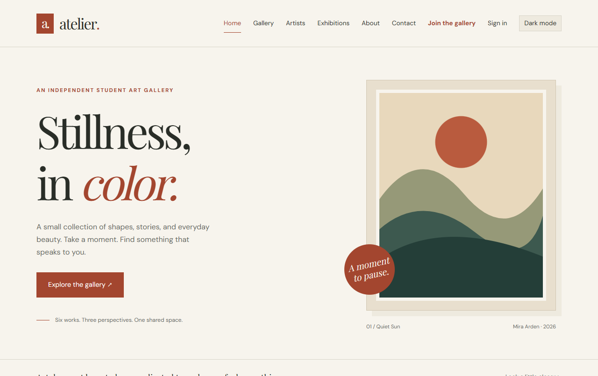 | 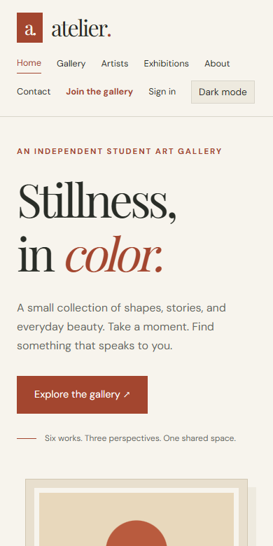 |

| Light theme | Dark theme after refresh |
| --- | --- |
| 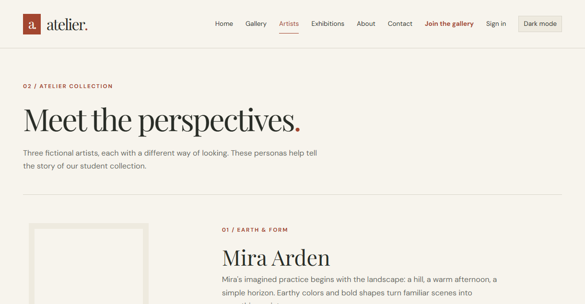 | 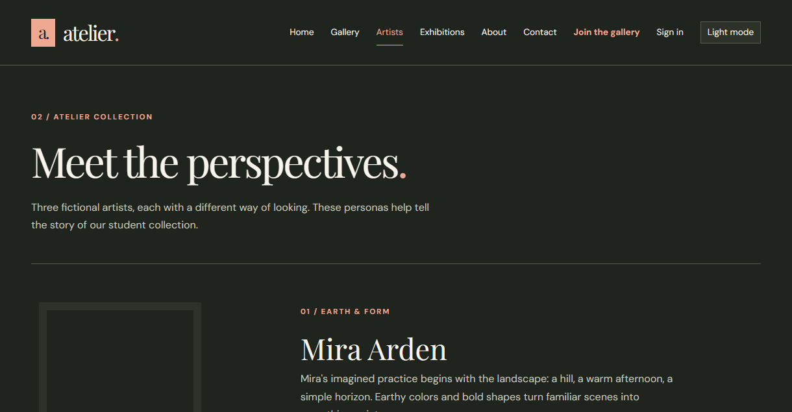 |

| Signed in after refresh | Signed out |
| --- | --- |
| 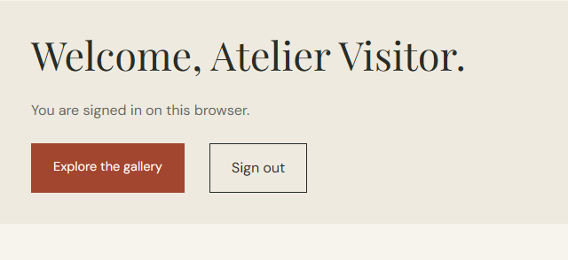 | 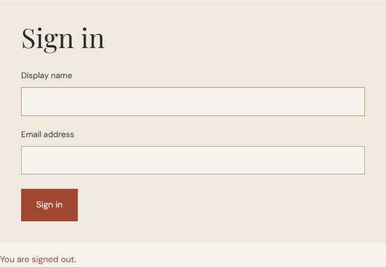 |

| FAQ collapsed | FAQ with an expanded answer |
| --- | --- |
| 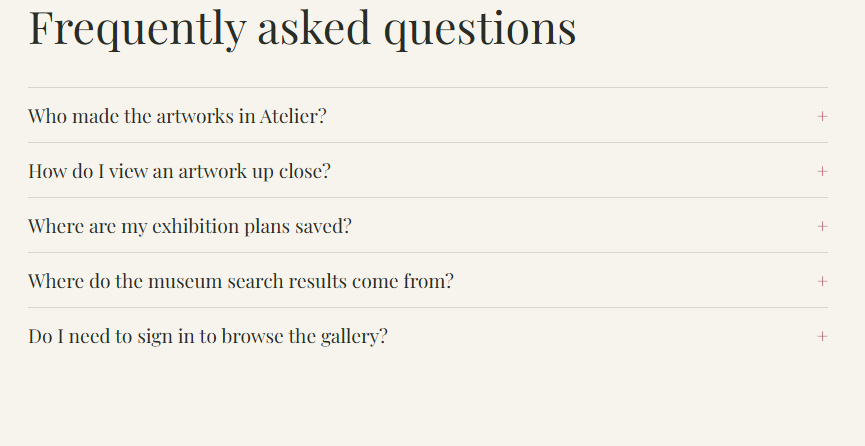 | 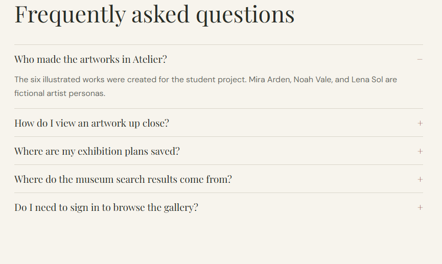 |

Searching for Monet returned six records from the Cleveland Museum of Art.

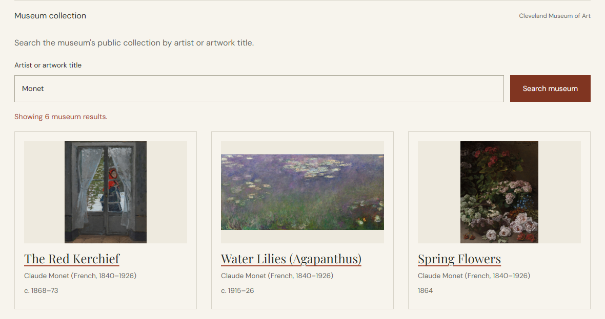

| Search returned no matches | Browser taken offline during search |
| --- | --- |
| 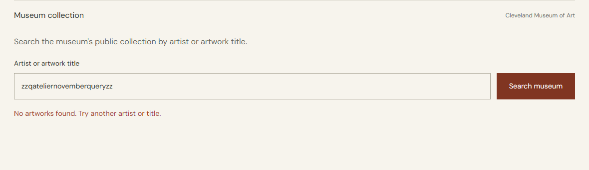 | 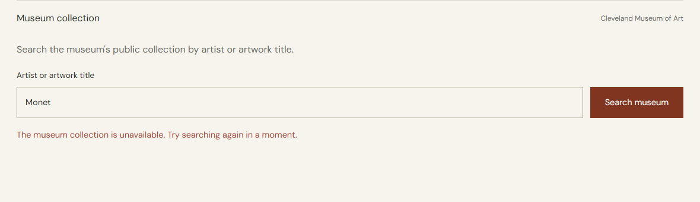 |
